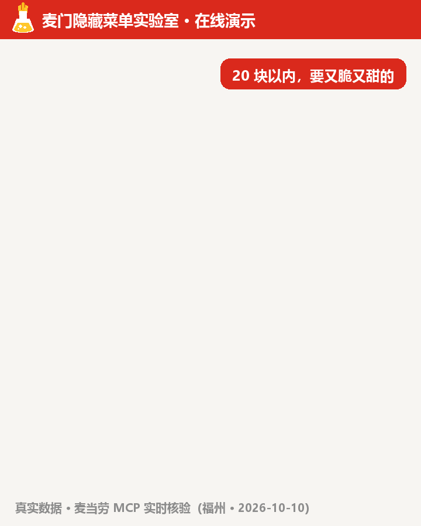
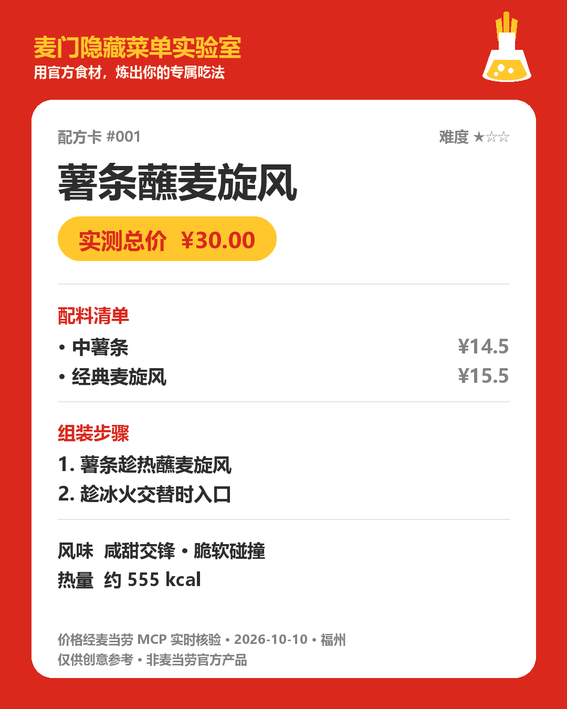
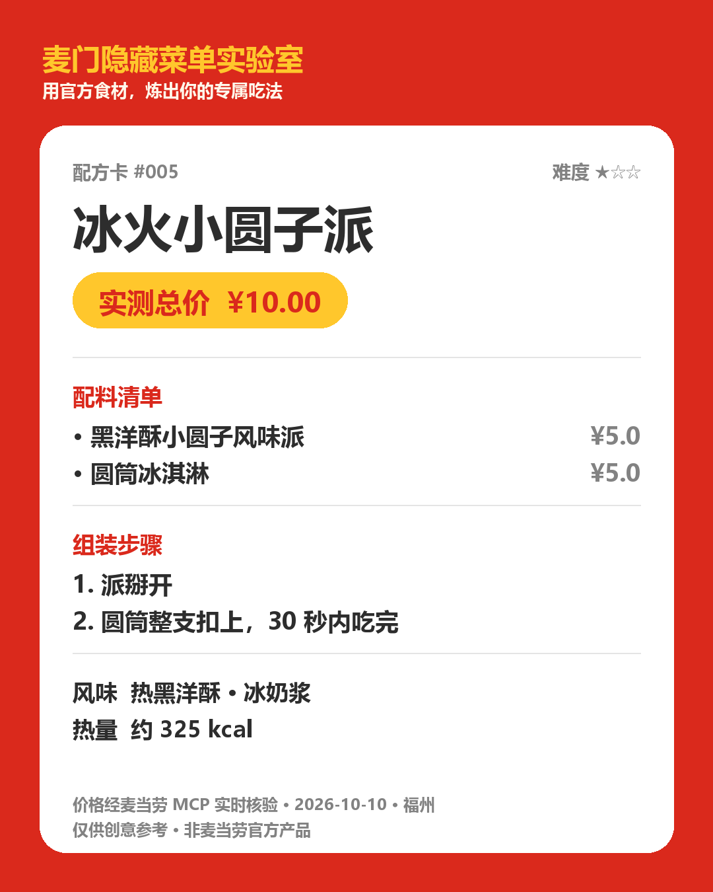

# 🔮 麦门隐藏菜单实验室


> 用麦当劳官方食材，炼出你的专属吃法。
> 全网网红隐藏吃法的**还原器** + 你的专属**配方发明机**。

[](https://github.com/Reak-Z/mcd-secret-menu-lab)
[](LICENSE)
[](https://github.com/M-China/mcd-mcp-server)
[](https://www.workbuddy.cn/)

**2026 麦当劳程序员创意开发大赛参赛作品** · 基于 [麦当劳中国官方 MCP](https://github.com/M-China/mcd-mcp-server) 开发 · 使用 [WorkBuddy](https://www.workbuddy.cn/) 构建

---

## 🍟 这是什么？

麦当劳的菜单是「原子」的，但吃法是「无限」的。

薯条蘸麦旋风、香芋派浇新地、甜筒坠入可乐…… 这些在社交平台被千万人点赞的**隐藏吃法**，从来没有人帮你系统地整理、验证和再创造。

**麦门隐藏菜单实验室** 是一个 AI Skill，做四件事：

| 模式 | 你说 | 它做 |
|---|---|---|
| 🔁 **还原** | “薯条蘸麦旋风怎么做？” | 调出网红隐藏吃法：买什么、怎么组装、什么味、几块钱 |
| 🧪 **创造** | “20 元以内、甜咸双杀的隐藏吃法” | 配方引擎现场发明新吃法，风味矩阵保证好吃逻辑 |
| 💰 **验价** | （自动） | 真实调用麦当劳 MCP 计价，写清楚花多少钱，不是瞎估 |
| 🛒 **落地** | “就按这个下单” | 生成到店组装指引，或经你确认后一键下单 |

每个配方都会生成一张可分享的 **「配方卡」** 📸

---

## 🎬 在线演示



---

## 🧪 配方卡长什么样

对话里实时输出的 Markdown 版：

```
╭─ 配方卡 #003 ──────────────────╮
│ 🥤🍦 雪顶可乐（McFloat）        │
│ 难度 ★☆☆   实测总价 ¥14.50     │
├────────────────────────────────┤
│ 配料清单                        │
│ · 中杯可乐           ¥9.5       │
│ · 圆筒冰淇淋         ¥5.0       │
├────────────────────────────────┤
│ 组装                            │
│ 1. 可乐先喝掉两口               │
│ 2. 圆筒倒扣进去，等 30 秒       │
├────────────────────────────────┤
│ 风味：气泡冲击 · 奶香雪崩        │
│ 热量：约 240 kcal（官方营养表）  │
╰────────────────────────────────╯
```

还能一键生成**图片版配方卡**（1080×1350，可直接发社交媒体）：

<p>

&nbsp;

</p>

## 📊 真实实测（2026-10-10）

> 不是纸上谈兵：以下价格全部由麦当劳 MCP `calculate-price` **实时核验**（门店：福州五四路省农科院店）

| 配方 | 配料 | 实测总价 |
|---|---|---|
| #001 薯条蘸麦旋风 | 中薯条 + 经典麦旋风 | **¥30.00** |
| #002 派上浇冰 | 派（香芋派）+ 新地 | **¥20.50** |
| #003 雪顶可乐 | 可乐 + 圆筒冰淇淋 | **¥14.50** |
| #004 芝士瀑布薯条 | 中薯条 + 韩式烟熏芝士酱 | **¥17.50** |
| #005 冰火小圆子派 | 黑洋酥小圆子派 + 圆筒 | **¥10.00** |
| #006 双酱鸡块 | 麦乐鸡5块 + 双酱 | **¥20.00** |
| #007 早餐王牌 | 枫糖厚松饼猪柳蛋堡 + 脆薯饼 | **¥30.50** |
| #008 酸甜脆薯 | 中薯条（含免费番茄酱&糖） | **¥14.50** |
| #009 雪顶麦炫酷 | 阳光橙麦炫酷 + 圆筒 | **¥17.50** |
| #010 麦旋风双拼 | 经典麦旋风 + 小圆子派 | **¥20.50** |
| #011 星星撞薯 | 泷盐星星麦旋风 + 中薯条 | **¥31.00** |
| #012 扭扭芝士塔 | 扭扭薯 + 烟熏芝士酱 | **¥19.00** |
| #013 红茶雪顶 | 柠檬红茶 + 圆筒冰淇淋 | **¥14.50** |
| #014 焦香撞冰 | 薄皮焦香V翅 + 新地 | **¥28.50** |

完整核验记录（含调用链与原始数据）：[examples/live-verification-2026-10-10.md](examples/live-verification-2026-10-10.md)

---

## 🚀 快速开始

### 1. 申请麦当劳 MCP Token

前往 [open.mcd.cn/mcp](https://open.mcd.cn/mcp) → 手机号登录 → 右上角「控制台」→「激活」→ 复制 Token。

### 2. 配置 MCP 连接器（以 WorkBuddy 为例）

左侧边栏【专家·技能·连接器】→【连接器】→ 右上角【自定义连接器】→【配置 MCP】，填入 `mcp-config.example.json` 的内容并替换 `YOUR_MCP_TOKEN`。

> 其他客户端（Cursor / Cherry Studio / Trae / VSCode 等）配置方式相同，见[官方接入指南](https://github.com/M-China/mcd-mcp-server)。

### 3. 安装本 Skill

**一键安装**（自动探测 WorkBuddy / Claude Code 技能目录）：

```bash
python tools/install.py
```

或手动复制 `SKILL.md` 与 `references/` 到你的技能目录：

- **WorkBuddy**：`~/.workbuddy/skills/mcd-secret-menu-lab/`
- **Claude Code / 其他 Agent**：放入对应 skills 目录即可（SKILL.md 为通用格式）

### 4. 开聊

```
你：20 块以内，要又脆又甜的，帮我发明一个

🔮 实验室：
  ① 扫描门店菜单（130 项真实在售）
  ② 风味矩阵匹配 → 生成候选组合
  ③ calculate-price 实时计价复核 ✓

  ╭─ 配方卡 #004 芝士瀑布薯条 · 实测 ¥17.50 ╮
  ╰─ 配方卡 #008 酸甜脆薯   · 实测 ¥14.50 ╯

你：就按芝士瀑布那个下单

🔮 实验室：门店确认 → 金额复核 → 明细确认 →【等你确认】→ 下单成功
```

---

## 📁 仓库结构

```
├── SKILL.md                    # 技能主体（四大模式 + 风味矩阵 + 配方卡模板）
├── references/
│   ├── recipes.md              # 配方库 v2（实测版：真实价格 + 营养）
│   └── flavor-matrix.md        # 风味兼容性矩阵（配方引擎的知识内核）
├── tools/
│   ├── install.py              # 一键安装脚本（WorkBuddy / Claude Code）
│   ├── emblem.py               # 原创项目标识（烧瓶薯条图形，非官方 Logo）
│   ├── make_recipe_card.py     # 配方卡图片生成器（1080×1350 可分享版式）
│   ├── make_demo_gif.py        # 对话演示 GIF 生成器
│   └── make_social_poster.py   # 社交物料生成器（封面海报 + 合集图）
├── assets/
│   ├── emblem.png              # 项目标识（原创图形）
│   ├── cards/                  # 生成的配方卡图片（14 张）
│   ├── social/                 # 传播物料（封面海报 + 配方合集图）
│   └── demo.gif                # 对话演示动画
├── examples/
│   └── live-verification-2026-10-10.md  # 真实链路核验记录
├── MCP_INTEGRATION.md          # MCP 工具调用流程、业务价值与踩坑记录
├── mcp-config.example.json     # 脱敏后的 MCP 配置示例（仅环境变量占位符）
├── workbuddy.md                # WorkBuddy 开发对话上下文（联动活动核验用）
├── CONTEST_DECLARATION.md      # 参赛声明（官方原文，不可修改）
└── README.md
```

---

## 🗺️ Roadmap

- [x] 配方库 v1（10 个经典隐藏吃法）
- [x] 风味兼容性矩阵 v1
- [x] **MCP 真实链路核验**（2026-10-10 完成：10 个配方全部实测计价 + 158 项营养数据）
- [x] **配方卡图片生成器**（2026-10-10：1080×1350 可分享版式，一键出图）
- [x] **对话演示 GIF**（2026-10-10：11 帧动画，183KB，见上方演示）
- [ ] 社区配方征集（欢迎 PR 你的独门吃法！）

---

## 🏆 参赛信息

- 赛事：[2026 麦当劳程序员创意开发大赛](https://github.com/M-China/mcd-developer-innovation-challenge)
- 开发工具：[WorkBuddy](https://www.workbuddy.cn/)
- 参赛状态：✅ **已通过官方核验，成功参赛**（[Issue #272](https://github.com/M-China/mcd-developer-innovation-challenge/issues/272)，2026-10-10 官方确认）

---

## ⚠️ 声明

- 本项目为麦当劳程序员创意开发大赛参赛作品，由参赛者独立开发，**非麦当劳官方产品**
- 项目输出仅供参考，不构成医疗、营养或其他专业建议；餐品信息、价格及供应状态以麦当劳官方渠道的实时结果为准
- 下单、积分兑换等资金/权益操作均需用户显式确认后执行
- 本仓库不包含任何真实 Token，请通过官方渠道申请并妥善保管
- 项目标识为**原创图形**（烧瓶+薯条），未使用任何麦当劳注册商标；文中「麦当劳」「麦门」等字样仅作说明性引用

## 📜 License

MIT
